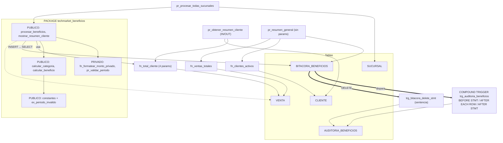

# Fase 1 – Entregables EP2 TechMarket

**Integrantes y responsabilidades**
- **Pablo Quintino:** funciones y package (E01, E02, E03, E07, E08).
- **Danyer Cordova:** triggers y excepciones (E09 a E14).
- **Max Herrera:** procedimientos, integración, base EP1 (E00, E04, E05, E06, E15, C01, C02), diagramas e informe.

## Orden de ejecución en SQL Developer (F5, Run Script)
1. `02_SQL/script_maestro.sql` (solo si la BD está vacía o quieren partir de cero)
2. `02_SQL/script_EP2_completo.sql` → al final, `SELECT FROM user_errors` debe salir vacío
3. `02_SQL/test_EP2_evidencias.sql` → ejecutar **E00 primero**, luego cada sección por separado

## Resumen de cambios respecto al repo
1. **Hallazgo:** `PACKAGE_BODY_y_TRIGGER.sql` (repo anterior) ya tenía un compound trigger y `fn_formatear_monto_privado`, pero **nunca llegaron a `script_maestro.sql`** (ahí el trigger es solo fila y el package no tiene privados). El nuevo script los integra.
2. Funciones nuevas: `fn_clientes_activos` y `fn_ventas_totales` (sin parámetros), `fn_total_cliente` (4 parámetros; sucursal NULL = todas).
3. Procedimientos nuevos: `pr_resumen_general` (sin parámetros, BULK COLLECT), `pr_obtener_resumen_cliente` (IN/OUT), `pr_procesar_todas_sucursales` (masivo, recorre sucursales).
4. Package `techmarket_beneficios` reemplazado. **Público:** 3 constantes de umbral, excepción `ex_periodo_invalido`, `calcular_categoria`, `calcular_beneficio`, `procesar_beneficios`, `mostrar_resumen_cliente`. **Privado:** `fn_formatear_monto_privado`, `pr_validar_periodo`.
5. `procesar_beneficios` del **package** pasó de LOOP fila a fila a un único `INSERT … SELECT … GROUP BY` (mismo resultado, más masivo, y el trigger de sentencia dispara 1 vez). El procedimiento **standalone** de EP1 quedó intacto a propósito: sirve de contraste (E10).
6. `trg_auditoria_beneficios` ahora es un **COMPOUND TRIGGER real**: BEFORE STATEMENT + AFTER EACH ROW + AFTER STATEMENT. Mantiene el mismo nombre (se hace DROP + CREATE) → no audita doble.
7. Trigger simple `trg_bitacora_delete_stmt` (AFTER DELETE, sentencia): un DELETE de N filas deja 1 marca. Lo usé en vez del "BEFORE INSERT" sugerido porque su propósito es distinto al del compound y no duplica mensajes.
8. Utilitario de pruebas `pr_demo_reiniciar` (solo en el script de pruebas) deja cada evidencia en estado limpio y silencioso.
9. 16 secciones de evidencia (E00–E15) con el resultado esperado anotado en cada una.
10. Sin cambios en tablas, datos ni bloques EP1 (RECORD/VARRAY/cursores/excepciones).

## Capturas a tomar (guardar en `04_Evidencias/EP2/`)
| Archivo sugerido | Sección | Quién | Indicador |
|---|---|---|---|
| E00_objetos_validos.png | E00 | Max | Base de todo |
| E01_funcion_sin_param.png | E01 | Pablo | IE2.1.3 |
| E02_funcion_param_en_select.png (incluye valores límite) | E02 | Pablo | IE2.1.3 |
| E03_funcion_en_plsql.png | E03 | Pablo | IE2.1.3 |
| E04_proc_param_masivo.png | E04 | Max | IE2.1.1 |
| E05_proc_sin_param.png | E05 | Max | IE2.1.1 |
| E06_proc_out_desde_plsql.png | E06 | Max | IE2.1.1 |
| E07_package_publico.png (DESC + bloque) | E07 | Pablo | IE2.2.1 |
| E08_package_privado_error.png (error + USER_SOURCE) | E08 | Pablo | IE2.2.1 |
| E09_trigger_compound_insert.png (tipo COMPOUND + mensajes + auditoría) | E09 | Danyer | IE2.3.1 |
| E10_trigger_contraste_loop.png | E10 | Danyer | IE2.3.1 |
| E11_trigger_update_multifila.png | E11 | Danyer | IE2.3.1 |
| E12_trigger_update_0filas.png | E12 | Danyer | IE2.3.1 |
| E13_trigger_sentencia_delete.png | E13 | Danyer | IE2.3.1 |
| E14_excepciones.png | E14 | Danyer | Apoyo |
| E15_integracion.png | E15 | Max | Integración |
| C01_record_varray.png / C02_cursores.png | C01, C02 | Max | Base EP1 |

Cada captura debe mostrar el código y el resultado, y el nombre de la conexión visible en el panel izquierdo.

## Diagrama de dependencias (Mermaid)

## Supuestos
- Se corre sobre los datos de `script_maestro.sql` (sucursal 10 y 20, agosto 2026); los "esperados" de cada sección están calculados con esos datos.
- No pude ejecutar Oracle aquí; revisé a mano nombres, orden de creación y `/` finales. Si algo no compila, pasen el error en la Fase 2.
- Las capturas E11–E13 hacen `ROLLBACK` al final para dejar la bitácora limpia.
